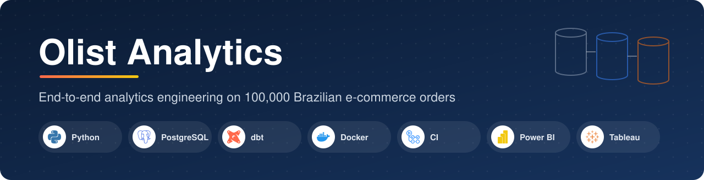
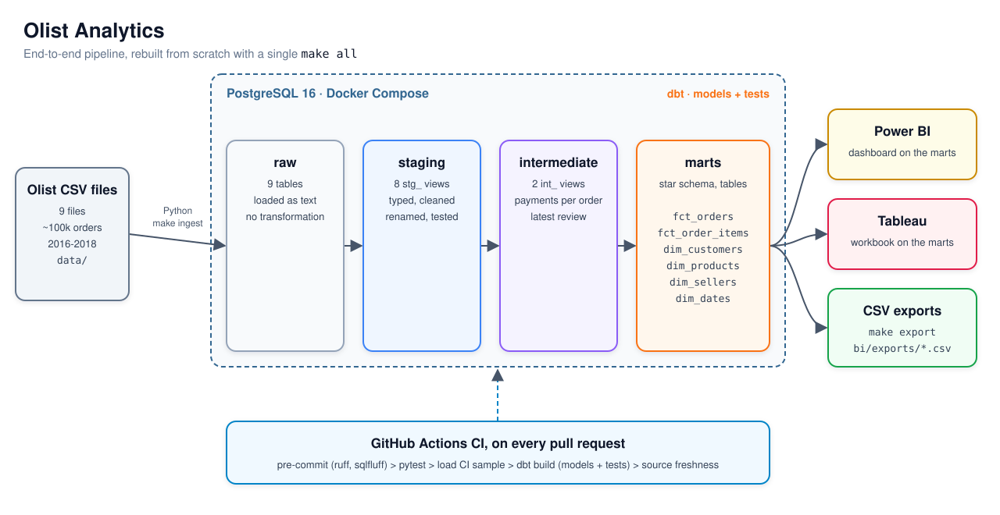

<p align="center">
  
</p>

<p align="center">
  <em>From 9 raw CSV files to a tested star schema and two BI dashboards that agree to the cent,
  rebuilt from scratch with a single command.</em>
</p>

<p align="center">
  <a href="https://github.com/CyrilleAdrien/Olist-Analytics/actions/workflows/ci.yml"></a>
  
  
  
  
  <a href="https://creativecommons.org/licenses/by-nc-sa/4.0/"></a>
</p>

<p align="center">
  <a href="#architecture"></a>
  <a href="#quick-start"></a>
  <a href="#results"></a>
  <a href="#dashboards"></a>
</p>

## What is Olist Analytics?

An end-to-end analytics engineering project on the
[Brazilian E-Commerce Public Dataset by Olist](https://www.kaggle.com/datasets/olistbr/brazilian-ecommerce):
CSV ingestion in Python, a PostgreSQL warehouse, dbt models and tests, and Power BI and
Tableau dashboards that show the same figures. The whole pipeline runs in Docker and is rebuilt
from scratch with a single `make all`.

## Key features

- 🐳 **Reproducible.** One `make all` starts PostgreSQL in Docker, loads the raw files and builds every model.
- 🧱 **Layered dbt project.** `raw` → `staging` → `intermediate` → `marts`, ending in a star schema.
- ✅ **Tested data.** 94 data tests plus a revenue reconciliation test between the two fact tables.
- 🔁 **CI on every pull request.** Lint, unit tests, a sample load and `dbt build` in GitHub Actions.
- 📊 **One truth, three tools.** SQL, Power BI and Tableau return the same revenue, orders, basket and score.
- 📚 **Documented.** Every column and KPI is described in the dbt docs (`make docs`).

## Context

Olist is a Brazilian marketplace that connects small sellers to the large e-commerce
platforms. The public dataset covers about 100,000 orders placed between 2016 and 2018, spread
over 9 CSV files: orders, items, payments, reviews, customers, sellers, products, category
translations and geolocation.

The raw files are not ready for reporting: an order can have several items, payments and
reviews, a customer gets a new `customer_id` for every order, and dates and amounts are stored
as text. The goal of the project is a tested, documented model that answers four business
questions, with the same numbers in every tool:

- How much does the marketplace sell, and in which categories?
- How many orders, and what is the average basket?
- Are orders delivered on time, and does lateness hurt the review score?
- Do customers come back?

## Architecture



The editable source is [docs/olist-architecture.drawio](docs/olist-architecture.drawio) (open it on [draw.io](https://app.diagrams.net)).

| Layer | Tool | Schema | Materialisation |
| --- | --- | --- | --- |
| Ingestion | Python 3.12, psycopg | `raw` | Tables, values kept as text |
| Staging | dbt | `staging` | Views, one per source table |
| Intermediate | dbt | `intermediate` | Views |
| Marts | dbt | `marts` | Tables (star schema) |
| BI | Power BI, Tableau | reads `marts` only | |

## Quick start

Requirements: Docker with Docker Compose v2 and GNU Make. Python 3.12 and `pre-commit` are only
needed for local development.

```bash
git clone https://github.com/CyrilleAdrien/Olist-Analytics.git && cd Olist-Analytics
cp .env.example .env        # then set POSTGRES_PASSWORD (make creates it if missing)
# download the dataset from Kaggle and unzip the 9 CSV files into data/ (git-ignored)
make all                    # up -> ingest -> build
make kpis                   # print the reference KPIs
```

Without the Kaggle files, `make all DATA_DIR=data/sample` runs the whole chain on the committed
sample (about 1,000 orders).

| Command | Effect |
| --- | --- |
| `make up` | Start the PostgreSQL 16 warehouse (`localhost:5432`) |
| `make ingest` | Load the CSV files of `DATA_DIR` (default `data/`) into the `raw` schema |
| `make build` | Run `dbt deps` then `dbt build` (models and tests) |
| `make all` | Chain `up`, `ingest` and `build` |
| `make kpis` | Run `bi/reference_kpis.sql` against the warehouse |
| `make export` | Export the marts to `bi/exports/*.csv` (for Tableau Public) |
| `make docs` | Serve the dbt documentation on `localhost:8080` |
| `make test` | Run the ingestion tests |
| `make lint` | Run every pre-commit hook |
| `make down` | Stop every service |
| `make clean` | Stop every service and delete the warehouse volume |

Credentials live in `.env` (never committed); `.env.example` documents every variable.

### Services

| Service | Role |
| --- | --- |
| `warehouse` | PostgreSQL 16, port 5432 exposed for BI tools, persistent volume |
| `pipeline` | Python 3.12 image with the ingestion script and dbt, started on demand |
| `docs` | `dbt docs serve` on port 8080 |

## Ingestion

`ingestion/load_raw.py` loads the 9 files into the `raw` schema, one table per file. Each run
truncates and reloads every table in its own transaction, so the dbt views built on `raw` stay
valid. Values are kept as text (zip codes keep their leading zeros) and typed in dbt staging;
every row gets a `_loaded_at` timestamp for `dbt source freshness`. The script checks that all
files are present and that their headers match the expected columns before loading anything.

`data/sample/` holds about 1,000 orders with every linked customer, item, payment, review,
product and seller, for the CI. It is rebuilt deterministically from the full dataset with
`python -m ingestion.build_sample`, and it deliberately includes customers with several orders
and orders with several reviews.

## dbt models

```
dbt/models/
├── staging/        stg_olist__*            8 views, one per source table
├── intermediate/   int_payments__per_order, int_reviews__latest_per_order
└── marts/          fct_orders, fct_order_items, dim_customers, dim_products, dim_sellers, dim_dates
```

**Staging** casts types and renames columns, one view per source table; only
`stg_olist__products` joins the category translation to add the English name. Geolocation is not modelled: it has several coordinates per zip code and no
KPI needs it.

**Intermediate** brings the many-row tables down to one row per order:
`int_payments__per_order` sums the payments, and `int_reviews__latest_per_order` keeps the most
recently answered review, so that orders with several reviews are not counted twice.

**Marts** form a star schema:

| Model | Grain | Main columns |
| --- | --- | --- |
| `fct_orders` | One row per order | status, dates, `items_revenue_brl`, `freight_value_brl`, payments, `review_score`, `delivery_days`, `is_delivered`, `is_late` |
| `fct_order_items` | One row per order item | `product_id`, `seller_id`, `price_brl`, `freight_value_brl`, `is_delivered` |
| `dim_customers` | One row per `customer_unique_id` | state, city, first and last order, `orders_count`, `is_repeat_customer` |
| `dim_products` | One row per product | category in Portuguese and English, dimensions |
| `dim_sellers` | One row per seller | state, city |
| `dim_dates` | One row per day, 2016-01-01 to 2018-12-31 | year, quarter, month, week, day of week |

**Tests**: unique and not-null keys, relationships between facts and dimensions, accepted values
for statuses and scores, ranges with `dbt-expectations`, and a singular test
(`assert_revenue_reconciles_between_facts`) that checks that revenue is the same in
`fct_orders` and `fct_order_items`. `dbt build` runs 111 nodes (models and tests) on the full
dataset. Every column and KPI is documented in `make docs`.

## KPI definitions

Every KPI is computed on delivered orders (`is_delivered = true`). The definitions live in
`dbt/models/marts/_kpi_docs.md`, and the same rules are used in SQL, DAX and Tableau.

| KPI | Definition |
| --- | --- |
| Revenue | Sum of item prices, shipping excluded |
| Orders | Distinct count of `order_id` |
| Average basket | Revenue / orders, computed after aggregation |
| Average review score | One review per order (the latest answered) |
| Delivery time | Days between purchase and delivery to the customer |
| Late rate | Orders received after the estimated date / orders |
| Repeat purchase rate | Customers with 2+ delivered orders / customers with 1+, counted by `customer_unique_id` |

## Results

Full dataset, delivered orders, from `make kpis` (`bi/reference_kpis.sql`):

| KPI | Value |
| --- | ---: |
| Revenue | 13,221,498.11 BRL |
| Orders | 96,478 |
| Average basket | 137.04 BRL |
| Average review score | 4.16 / 5 |
| Freight | 2,198,275.64 BRL |
| Average delivery time | 12.50 days |
| Late rate | 6.77 % |
| Repeat purchase rate | 3.00 % |

What the figures say:

- **Delivery drives satisfaction.** About 1 order in 15 arrives late; the Logistics page
  compares the review score of on-time and late orders.
- **Customers rarely come back.** Only 3 % of customers place a second delivered order: growth
  comes from acquisition, not retention. Counting `customer_id` instead of
  `customer_unique_id` would hide even that.
- **Shipping is a significant cost.** Freight adds about 17 % on top of revenue, which matters
  for a basket of 137 BRL.

## Dashboards

Power BI and Tableau connect to the `marts` schema of the local warehouse and show the same
three pages:

| Page | Content |
| --- | --- |
| Overview | KPI cards (revenue, orders, average basket, average review score), monthly revenue, top 10 categories |
| Logistics | Average delivery time, late rate by customer state, review score on time vs late |
| Customers | Repeat purchase rate, customers by state, new customers per month |

- **Tableau**: packaged workbook `bi/Olist-analytics.twbx`, opens in Tableau Desktop or Tableau
  Reader without a database.
- **Power BI**: built from the measures and model in `bi/README.md`, saved as a Power BI
  project (PBIP) in `bi/powerbi/`.

`bi/README.md` gives the connection settings, the Power BI model and DAX measures, the Tableau
data source and calculated fields, and the consistency table that compares revenue, orders,
average basket and review score in SQL, Power BI and Tableau. All three tools give the same values.

## Continuous integration

`.github/workflows/ci.yml` runs on every pull request and on every push to `main`: it starts a
PostgreSQL 16 service, runs `pre-commit`, the ingestion tests, loads `data/sample/`, then runs
`dbt deps`, `dbt build` and `dbt source freshness`. The `manifest.json`, `run_results.json` and
`sources.json` files of `dbt/target/` are published as the `dbt-target` workflow artifact.

## Development

```bash
python -m venv .venv && source .venv/bin/activate
pip install -r requirements-dev.txt
pre-commit install
make lint
```

pre-commit runs `sqlfluff lint` (postgres dialect), `ruff`, `ruff format`, `check-yaml` and
`end-of-file-fixer` before each commit.

## Repository layout

```
.
├── ingestion/          CSV loader, sample builder and their tests
├── dbt/                dbt project: models, tests, macros, profiles
├── bi/                 reference KPI query, marts export, Tableau workbook, Power BI project
├── data/sample/        CI sample (the full dataset goes in data/, git-ignored)
├── .github/workflows/  CI
├── docker-compose.yml  warehouse, pipeline and docs services
├── Dockerfile          pipeline image (Python 3.12 + dbt)
└── Makefile            entry points
```

## Limits and next steps

- The dataset stops in 2018 and is anonymised: no product names, no customer demographics.
- The warehouse is rebuilt in full on each run; incremental models would be the next step for
  a live source.
- Geolocation is not modelled; delivery distance could explain part of the delays.

## Data licence

The Olist dataset is published under
[CC BY-NC-SA 4.0](https://creativecommons.org/licenses/by-nc-sa/4.0/).

## 📢 Author

**Cyrille FOTSO**, Data Engineer / DataOps.

<p>
  <a href="https://www.linkedin.com/in/cyrille-fotso-a25609428/"></a>
  <a href="https://github.com/CyrilleAdrien"></a>
</p>
